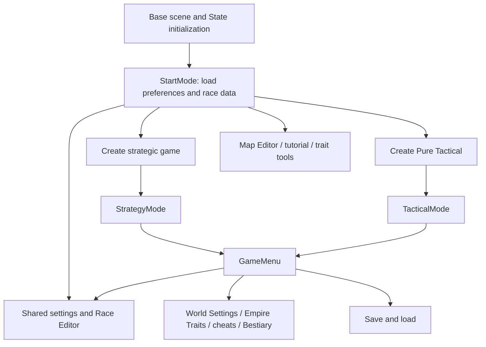

# Architecture study 01A — startup, navigation, and settings

**Status:** First study packet ready for review, 2026-10-30. The comprehensive study (spec 01) remains in progress. No gameplay code, scene, prefab, user preference, or asset was changed.

**Subsequent implementation:** This is a pre-cleanup study snapshot. [02A](../implementation/02a-settings-defaults-and-precedence.md) extracted defaults/loading; [02B](../implementation/02b-tool-retirement-and-race-editor-gate.md) has now retired the listed tool entries and implemented the Race Editor gate. [02C](../implementation/02c-settings-retirement-and-balance-locking.md) subsequently retired settings controls, locked their defaults and resolved the previously unmatched settings bindings/inherited callbacks. The original active-route inventory and old line anchors are historical evidence, not a claim those tools remain reachable.

## Findings that affect the conversion

The existing menu pages also initialize and apply gameplay configuration. Removing a screen without replacing those responsibilities could change balance, keep old saved overrides active, or leave null references. The first cleanup should establish explicit defaults and close obsolete navigation routes before retiring panel implementations.

Several important entry points are serialized as prefab-instance overrides in the base scene. Searching only for C# callers or literal UnityEvent method fields misses them. Race Editor has three callbacks marked enabled in the scene: its main-menu button, the in-game menu button, and the untagged-traits warning. Three preset buttons contain additional disabled editor callbacks; their actual slot-switching listeners are added in code. A password gate belongs at the shared editor-opening path, with a review of nested editor paths, rather than on one visible button.

Content settings are not currently a single global authority. Global preferences initialize the current WorldConfig, a save can replace that object, and the Content Settings page can either update only the running game or also store new defaults. The conversion's agreed global settings and developer-controlled balance need explicit ownership and precedence.

## Scope, evidence, and limits

This packet traced the base-scene menu components, StartMode/GameManager navigation, settings reads/writes, saved configuration replacement, Race Editor access/persistence, and selected authoring-tool dependencies. Source inspection was used because window capture remained unavailable in the previous baseline. The user confirmed main-menu startup; no further runtime checks were performed here.

Supporting inventories:

- [Scene components, 68 selected serialized routes, and the twelve-page index mapping](01a-scene-inventory.md).
- [213 Content Settings serialized bindings](01a-content-bindings.md), including 105 literal toggle defaults found in its control list. Binding counts include helpers/templates, not just player options.

The extraction resolved scene IDs, script GUIDs, direct persistent calls, selected prefab source references, and overridden callback targets/methods. It is not a full Unity importer. Some inherited callbacks and fourteen control bindings remain unresolved in the appendix. Ancestor activity, disabled callbacks, runtime listeners, external assets, and remaining generation/serialization paths need their own review; a serialized reference is evidence of wiring, not proof that a user can reach it in every mode.

## 1. Startup and mode ownership

The [enabled build scene](../../ProjectSettings/EditorBuildSettings.asset) is Assets/base.unity. Its GameManager owns references to StartMode, StrategyMode, TacticalMode, Recruit_Mode, EndScene, MapEditor, GameMenu, VariableEditor, and UnitEditor.

- [GameManager.Start](../../Assets/Scripts/Core/GameManager.cs#L111) selects Start_Mode and assigns State.GameManager. Its CurrentScene setter hides the old mode's UI and shows the next mode's UI; these are largely screen/mode transitions inside the same scene.
- [StartMode.Start](../../Assets/Scripts/Modes/StartMode.cs#L21) loads ordinary options and cheat preferences, refreshes content settings, registers the three race preset listeners, loads edited race data, and initializes the untagged-trait warning UI. Unity controls the relative Start callback order; this study has not established a new explicit initialization sequence.
- The [State static initializer](../../Assets/Scripts/Core/State.cs) creates user-data paths, seeds missing default files, loads bundles/names/events and trait data. On Windows, the normal UserData paths are relative to the working directory, with fallback paths on failure. The project/build directory alone does not establish where an already-running copy is storing data.
- [GameManager.Update](../../Assets/Scripts/Core/GameManager.cs) dispatches menu updates or mode input, also retaining the old tutorial update path. Removing tutorial/menu references requires reviewing these calls.

This diagram describes the old game's wiring, including routes slated for retirement. It does not approve retaining those features.

### Navigation chains and replacement points

| Player entry | Current action → state/UI effect | Disposition and dependency |
|---|---|---|
| Create Strategic | StartMode.CreateStrategic → hide start UI → activate CreateStrategicGame → ClearState | Replace with company creation after cleanup. Its configuration-import and world-creation roles are separate dependencies. |
| Create Pure Tactical | StartMode.CreateTactical → activate CreateTacticalGame → Open | Preserve; species and battle setup are studied in the next packets. |
| Map Editor | StartMode.MapEditor → new World(true) → GameManager.SwitchToMapEditor; a separate in-game path can enter from StrategyMode | Retire both entry contexts; do not leave the world-creation side effect reachable. |
| Gameplay Tutorial | StartMode.TutorialMode → new TutorialScript → State.Load of StreamingAssets/Tutorial.sav | Retire startup entry and tutorial-specific update/input paths. |
| Load Saved Game | StartMode.LoadGame → GameManager.OpenSaveLoadMenu → GameMenu.OpenSaveLoadMenu | Preserve the user purpose, replace old save-format/return-mode assumptions in spec 06. |
| In-game menu | StrategyMode/TacticalMode ReceiveInput → Input Menu → GameManager.OpenMenu → GameMenu.UpdateDisplay | Preserve shared menu behavior as appropriate. InputManager maps Menu to Escape. MapEditor also opens this menu. |
| Return to main menu | GameMenu.MainMenu → optional StrategyMode.ClearData → GameManager.SwitchToMainMenu → current mode cleanup + StartMode.ReturnToStart + strategic window cleanup | Rework the strategic dependencies before removing StrategyMode. |
| Return from battle | GameManager.SwitchToStrategyMode → PureTactical branch returns to main menu; campaign branch regenerates StrategyMode | Preserve the distinct skirmish exit while replacing the campaign return destination in spec 05/10. |

See [GameManager](../../Assets/Scripts/Core/GameManager.cs#L192), [StartMode](../../Assets/Scripts/Modes/StartMode.cs#L48), and [GameMenu](../../Assets/Scripts/Subwindows/GameMenu.cs) for these chains. This packet establishes navigation boundaries; it does not yet validate tactical result handling.

## 2. Settings lifecycle and precedence

### Current behavior

| Operation | Actual behavior | Consequence for retirement |
|---|---|---|
| Startup | StartMode calls Options.LoadFromStored, CheatMenu.LoadFromStored, and ContentSettings.Refresh | Hidden or inactive pages can still supply runtime configuration. Retire their initialization responsibilities explicitly. |
| ContentSettings.Refresh | Hard-loads building configuration, creates toggle/generated species controls when needed, reads PlayerPrefs fallbacks into Config.World | Default rules are entangled with UI instances. Deleting control bindings first would break the loader. |
| ContentSettings.Open | Reads Config.World into controls and soft-loads building UI/state | Opening is distinct from loading global defaults; it presents the running game's current settings. |
| ContentSettings.Exit | Calls SetValues and building SoftSave, then hides the page | The button labeled for this game changes runtime settings even without global persistence. |
| ContentSettings.ExitAndSave | Also calls SaveValues and building HardSave | Writes preferences/defaults and external building JSON as well as runtime state. |
| Escape while content settings are open | GameMenu.UpdateDisplay calls ContentSettings.Exit | It applies changes; it is not a generic cancel operation. |
| Load saved settings for this game | ConfirmRefresh → LoadSaved → Refresh → Open | Replaces running settings from stored global preferences. |
| Load campaign save | State.Load assigns Config.World = World.ConfigStorage, restores optional building config, then reloads ordinary Options and CheatMenu preferences | Save data can override balance/content independently of current global defaults. |
| Strategic setup imports content settings from a save | CreateStrategicGame.PickSaveForContentData deserializes World and assigns its configuration/building data | Another route to legacy overrides; retire with strategic creation. |

Current source links after packet 02A: [ContentSettings page](../../Assets/Scripts/Subwindows/ContentSettings.cs#L645), [Refresh](../../Assets/Scripts/Subwindows/ContentSettings.cs#L666), [extracted preference/default loader](../../Assets/Scripts/Core/ContentSettingsData.cs), [Open](../../Assets/Scripts/Subwindows/ContentSettings.cs#L734), [SetValues](../../Assets/Scripts/Subwindows/ContentSettings.cs#L913), [SaveValues](../../Assets/Scripts/Subwindows/ContentSettings.cs#L1238), [Exit paths](../../Assets/Scripts/Subwindows/ContentSettings.cs#L1476), [State.Load](../../Assets/Scripts/Core/State.cs#L649), [setup import](../../Assets/Scripts/Subwindows/CreateStrategicGame.cs#L352). The study above describes the pre-extraction ownership; the [02A record](../implementation/02a-settings-defaults-and-precedence.md) documents the implemented delegation and preserved precedence.

The page index is positional: ActivatePage uses SettingsPanels[PageSelector.value]. Removing or moving a panel requires updating the dropdown options and array together. Merely disabling a panel leaves a selectable page; changing only one array can select the wrong page or fail.

Building Settings is also called when other content pages are used: Refresh calls HardLoad, Open calls SoftLoad/LoadBuildingValues, and both exits call SoftSave. [BuildingSettings](../../Assets/Scripts/Subwindows/BuildingSettings.cs#L438) reads/writes Config.BuildConfig and UserData/buildingConfig.json. Retire this dependency before its panel component can be removed from ContentSettings.

SetValues includes live-world side effects, not just assignment: it can reset diplomatic relations, reload unit traits, or change unit attributes depending on what changed. These paths traverse old strategic units or tactical units. Preserve retained updates through a new owner, and retire only the corresponding unwanted behavior.

### Default values need an explicit source

[WorldConfig](../../Assets/Scripts/Core/WorldConfig.cs) field initializers, ResetDictionary, ContentSettings.CreateList, PlayerPrefs fallbacks, saved WorldConfig objects, and RaceSettings are different inputs. For example, ResetDictionary specifies DayNightEnabled=true, whereas ContentSettings.CreateList uses false as its preference fallback. WeightGain/WeightLoss are true in the control list even though many other effects default to false. The user's instruction to keep defaults cannot safely be implemented by discarding the UI and trusting arbitrary class initializers.

WorldConfig.GetValue also inserts false for most missing toggle keys (with a ClothingDiscards exception), rather than consulting every original control default. Removing a toggle key without supplying the intended retained value can therefore change gameplay.

**Proposed implementation order:** document effective source defaults, define explicit developer-controlled balance independently of widgets, apply retained global preferences through an allowlist, and enforce locked values after relevant loading paths. Do not wipe all PlayerPrefs to achieve this: preserve unrelated presentation preferences. The new campaign should not inherit obsolete empire-save configuration; normal new-format saves still need clear ownership rules.

## 3. Race Editor and authoring tools

### Race Editor entry and persistence

[GameMenu.OpenRaceEditor](../../Assets/Scripts/Subwindows/GameMenu.cs#L64) currently activates the panel and calls ShowPanel without a password. Three serialized callbacks have enabled call state: Start UI/Race Editor, Menu UI/Race Editor, and Start UI/Warning! Untagged Traits!. The latter also receives a runtime listener in StartMode.Start that toggles the trait-warning UI. Review both effects when gating it.

The three preset buttons contain disabled OpenRaceEditor callbacks. Their active behavior comes from StartMode's added listeners: State.ChangeRaceSlotUsed selects EditedRaces.dat, EditedRaces2.dat, or EditedRaces3.dat using the stored RaceEditorSlot preference. Gating editor access alone does not eliminate old race overrides already loaded at startup.

[RaceEditorPanel.ShowPanel](../../Assets/Scripts/Subwindows/RaceEditorPanel.cs#L117) builds species dropdowns from the enum and offers randomizer/custom/conditional traits plus normal traits and tags. Saving calls State.SaveEditedRaces and reloads live unit traits/spells, with additional empire updates. Cancel reloads the stored race data. Keep the developer's three normal tabs; update species eligibility and live-unit refresh behavior when the new company model exists.

[State.LoadRaceData/LoadEditedRaces](../../Assets/Scripts/Core/State.cs#L464) uses Odin-serialized race settings and sanitizes loaded data. Species eligibility must remain independently enforced even when editor presets contain old entries. The next study packet will trace the actual RaceSettings/runtime consumers.

RaceEditorPanel.ModifyUnitTags calls GameMenu.OpenUnitTags, which opens a separate UnitTagEditor panel. Keeping nested tag editing while removing standalone access requires preserving that dependency and preventing an ungated alternate opening path. The normal tab names hide an additional tagged-trait search panel, opened by ActivateTaggedTraitsPanel; keep the editor's required helpers rather than removing them just because their type contains Editor.

### Initial retirement manifest for screens/tools

| Item | Confirmed wiring | Shared dependency / planned action | Later check |
|---|---|---|---|
| Empire Traits | GameMenu.OpenEmpireTraits → EmpireSettingsUI.Open | Retire callback and empire-specific editor data flow. | Cannot open in either converted mode. |
| Cheat Menu | GameMenu.OpenCheats; startup and State.Load both call CheatMenu.LoadFromStored | Force retired cheat flags off through deliberate configuration ownership; removing the menu alone leaves persisted cheats active. | Old cheat preferences cannot expose unit editing or alter intended play. |
| Map Editor | StartMode.MapEditor and GameManager.SwitchToMapEditor | Retire both paths and menu button references; shared grid assets remain. | Neither start nor in-game menu enters it. |
| World Settings | GameMenu.ShowGameSettings → WorldSettings.Open; WorldSettings.EditWorldSettings → VariableEditor.Open(Config.World) | Retire the world/empire editor and reflection-based balance bypass. | Cannot edit locked campaign/battle rules through this path. |
| Bestiary | Scene button directly calls Bestiary Screen GameObject.SetActive | Retire direct activation, not just BestiaryPanel methods. | No surviving button activates the screen. |
| Randomizer Trait Editor | StartMode.ChangeRandomizableTraits → GameMenu.OpenRandomizerTraits | Retire authoring route, preserve runtime trait data until consumers are traced. | No authoring access; retained traits still resolve. |
| Custom Trait Editor | StartMode.ModifyCustomTraits → GameMenu.OpenCustomTraits | Same separation of authoring tools from runtime data. | No editor entry or null startup dependencies. |
| Conditional Trait Editor | StartMode.ModifyCondTraits → GameMenu.OpenCondTraits | Same separation; conditional runtime usage belongs to later packet. | Retained trait evaluation remains intact. |
| Assimilable Traits | StartMode.ChangeAssimilableTraits → AssimilateList.Initialize → VariableEditor.Open | Retire the authoring route; audit runtime assimilation separately before changing that mechanic. | No route opens its editor. |
| Race Editor | Three enabled serialized OpenRaceEditor callbacks, plus preset/data loaders | One shared convenience password gate; keep tabs and required nested helpers. | All enabled entry contexts gated; cancel/incorrect password safe. |
| Unit Tag Editor | RaceEditorPanel.ModifyUnitTags → GameMenu.OpenUnitTags | Preserve within gated Race Editor; no independent player access. | Nested editing still works and cannot open independently. |
| Unit Editor | Cheat preference controls an InfoPanel text link; UnitInfoPanel handles that link and opens UnitEditor on Unit or Actor | Retire clickable link, opening path, and persisted enable flag. | Unit inspection still works; no UnitEditor link. |
| Variable Editor | WorldSettings and Assimilable Traits use reflection editor; GameMenu handles its close/save | Remove exposed routes; retain a helper only if a retained feature demonstrably requires it. | No reflection path changes player balance. |
| Help | Main-menu/in-game GameMenu.LoadHelp → HelpPanel.GenerateButtonsIfNeeded → display | Retain navigation, rewrite content late. | Current behavior recorded; converted help matches final game. |

The [scene appendix](01a-scene-inventory.md) gives component IDs and serialized source locations. [UnitInfoPanel](../../Assets/Scripts/UI/UnitInfoPanel.cs#L103), [InfoPanel](../../Assets/Scripts/Subwindows/InfoPanel.cs#L879), [WorldSettings](../../Assets/Scripts/Subwindows/WorldSettings.cs), and [VariableEditor](../../Assets/Scripts/Subwindows/VariableEditor.cs#L29) establish the non-menu paths above. Other dynamic callers remain part of the comprehensive study; this table is not permission to remove their shared implementations now.

## 4. Ordinary Options exceptions and maintenance controls

Keep the user's existing direction for General Options. Two findings deserve accurate classification rather than an automatic new removal decision:

- AutoUseAI is a gameplay-control preference: [TacticalMode](../../Assets/Scripts/Modes/TacticalMode.cs#L4438) can automatically hand a player-controlled turn to AI. This is not merely animation speed. Decide its intended campaign availability before changing it; it may remain useful in Pure Tactical.
- HardLava is used in [TileLogic](../../Assets/Scripts/Utility/TileLogic.cs#L303) while constructing terrain overlays. This packet does not establish a balance effect; do not remove it based only on its name.

[Options](../../Assets/Scripts/Subwindows/Options.cs#L67) also contains Clear All Saved Options/Content Settings, Wipe Userdata, Reset Namelists, and Update Namelists. ClearAllSettings calls PlayerPrefs.DeleteAll; Wipe Userdata reaches State.WipeUserdata. These are actual maintenance operations rather than presentation preferences. They were inspected only as source, never invoked. No recommendation here authorizes deleting preferences/files or changing the user's previous keep decision; classify them accurately before the options pass.

## 5. Recommended first cleanup batches

After the remaining architecture packets establish combat/content dependencies, refine spec 02 into these reviewable batches:

1. **Configuration ownership:** capture retained default values and their load precedence; define which values players may change; prevent saved cheat/locked-balance overrides from winning. Keep retained cosmetic/content preferences. Do not reset user data.
2. **Navigation closure:** retire the agreed startup/in-game tool entries and direct activation callbacks; gate all Race Editor opening contexts and preserve nested tags. Remove corresponding menu update/input dependencies with the same batch.
3. **Content page retirement:** update panel array and selector together; detach BuildingSettings calls before retiring that UI; replace control-backed reads/writes for retired controls. Keep live updates required by retained settings.
4. **Eligibility/settings integration:** replace enum-built species controls with the curated registry from spec 03. Handle empty eligible lists and saved race presets without reviving forbidden species.
5. **Source/scene review and later runtime checks:** check retired paths, references, incorrect-password/cancel handling, saved overrides, retained option persistence, and both mode exits. Compile and perform player-facing checks when that implementation stage is authorized.

Whole-file retirement/moves remain subject to AGENTS.md; this plan makes no deletions. A clean slate needs replacement owners for shared initialization before obsolete panels can disappear.

## Remaining study work

- **01B — species and content:** generation/fallback/summon routes, race-data application, bundle/graphic/name references, complete legacy event/narrative inventory, and the removal-name mapping.
- **01C — units and tactical combat:** equipment/stat assumptions, traits/AI, damage/surrender/digestion/retreat, terrain, battle result ownership, and reusable battle boundary.
- **01D — campaign and persistence:** strategic scheduling, world generation, identity and save/load, proposed company model, daily update order, and safe removal sequence across the remaining specs.

Review 01A before moving to the next packet. The removal manifest, risk register, and implementation specs remain provisional until all necessary packets are reconciled. This study packet required source/serialization inspection only; no build or playtest was run for these documentation changes.
