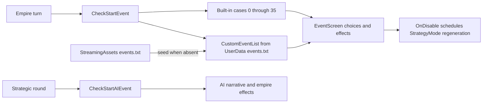

# Architecture study 01B — species, events, and narrative

**Status:** Second study packet ready for review, 2026-10-30. Source/content inspection only. No species, event, narrative string, setting, code, scene, or asset has been changed.

**Subsequent event implementation:** [04A](../implementation/04a-legacy-event-retirement.md) now retires the old 4X event sources and loading described in this study. The event call chains/line anchors below remain historical evidence; tactical prose work is still 04B.

## Findings that determine the removal order

All 90 user-designated removal names match existing Race enum entries and registry classes. The difficult part is closing every way those entries can be constructed, transformed into, displayed, or restored from data. The game's old empire/mercenary/monster numeric ranges are used as behavior rules in several places; they do not implement the agreed sapient/animal roles.

There are concrete bypasses to a simple recruitment filter: Pure Tactical preview units use Cats, narrative helpers create Humans units, and the Summon spell falls back to Vagrants when its eligible list is empty. All three are on the removal list. Species eligibility therefore has to cover helper objects, previews, summons, transformations, and loaded data as well as recruit/enemy generation.

Retiring events and resetting combat prose are separate jobs. The old 4X choice/AI events have world-changing effects and external file loading. Tactical prose is selected from a large coded registry plus inline formatting and callback text. Replacing only the obvious text file or the main registry would leave legacy content active.

## Evidence and limits

Supporting inventories:

- [All 90 rejected names mapped to enum IDs, registry classes, and candidate bundle dependencies](01b-species-removal-map.md).
- [103 explicit construction candidates and 45 race-write/change candidates](01b-species-creation-sites.md).
- [Twenty-two narrative groups and 2,492 lexical EventString occurrences](01b-narrative-inventory.md).
- [Legacy player/AI event cases, effects to inspect, and the custom-file route](01b-event-inventory.md).

The counts are source inventories, not runtime tests. Lexical matches can include comments, declarations, previews, and repeated calls. Candidate asset paths come from text manifests and loader references; binary bundles were not unpacked, and shared-asset ownership is not proven. External user files, private saves, and personal content were not read. Full live combat/result behavior belongs to packet 01C; serialization/identity reconciliation belongs to 01D.

## 1. Species identity and data layers

The [Race enum](../../Assets/Scripts/Enums/Race.cs) has 154 species/unique entries plus the none sentinel. Its legacy numeric ranges are main races 0–40, mercenaries 50–70, monsters 100–164, and named uniques 170–196. Do not renumber the remaining entries during cleanup: numeric casts, range tests, stored race data, and related enum/array assumptions still depend on those values.

The [Races registry](../../Assets/Scripts/Races/Races.cs) eagerly constructs graphics/default-data classes and selects them through GetRace. Enum names and class/field names differ: Taurus maps through Cows, Auri through Aurilika, and other entries use singular or alternate class names. Exact-name file searches alone are insufficient. GetRace(Unit) also selects special SlimeQueen/AntQueen leader variants. GetRace(Race) returns BlankSlate for unknown IDs; that fallback must not become an automatic playable replacement for a forbidden species.

[RaceParameters](../../Assets/Scripts/Races/RaceParameters.cs#L170) supplies stats, traits, descriptions, innate spells, role-related properties, and transformation mappings. GetRaceTraits reuses a temporary Unit; race data is not simply an art registry. [RaceSettings](../../Assets/Scripts/Utility/Stored/RaceSettings.cs) adds Odin-serialized overrides, including stats/traits and spawn, conversion, leader, and morph races. Missing overrides can be created lazily by Get. Sanitize repairs old values and injects the legacy FeralBats override; it is not a curated-species validator.

[Unit constructors](../../Assets/Scripts/Entities/Units/Unit.cs#L709) assign Race and then initialize stats, traits, names, appearance, gear, and spells without a curated-eligibility check. The short Unit(Race) constructor used by helpers also consumes random values for stats. Subclasses such as NPC_unit and Spawn pass into Unit initialization. NPC_unit currently uses a numeric race threshold to select its monster-generation path; that threshold cannot stand in for the new taxonomy.

**Proposed boundary:** keep stable content identity distinct from eligibility. Curated status, explicit sapient/animal role, and the player's global enablement should govern each creation/transformation/display context. Reject invalid start/generation requests before selecting or constructing a species. Audit the low-level constructors/setters as a backstop, but do not add a blanket GetRace exception that breaks startup or metadata inspection while every species is disabled.

## 2. Creation, transformation, and appearance routes

| Route | Current chain and evidence | Required conversion treatment |
|---|---|---|
| Pure Tactical selectors/previews | [CreateTacticalGame.Start/Open](../../Assets/Scripts/Subwindows/CreateTacticalGame.cs#L40) builds enum-wide dropdowns; AttackerRaceChanged/DefenderRaceChanged initially create a Cats Unit and assign Race directly | Use curated enabled choices; no Cats placeholder while empty. Keep setup usable without launching an invalid battle. |
| Pure Tactical random choice | [GetRandomRace](../../Assets/Scripts/Subwindows/CreateTacticalGame.cs#L570) samples values in a loop without returning them, then returns a numeric main-race selection | Replace with an explicit eligible pool during species work; do not claim the legacy implementation honors the settings. No eligible entry means a safe unavailable result. |
| Pure Tactical bulk runs | SingleRaceBatch and BattleAllCombinations build enum/range-based participant lists | Filter bulk participants as well as visible dropdowns. Preserve skirmish/bulk functionality for approved entries. |
| Actual tactical generation | CreateTactical creates a World(false), selects race delegates, and creates NPC_unit/Leader units | Validate final selected roles and every generated member, not just previews. |
| Recruitment and uniques | [MercenaryHouse](../../Assets/Scripts/Entities/MercenaryHouse.cs#L28) enumerates Merc keys; normal pool uses entries below Selicia and unique pool uses entries at/above Selicia | Retire unique generation; replace normal pool with approved sapients. A boolean Merc key is not enough to enforce company roles. |
| Villages, old armies, monsters, and events | Village, Empire, Recruit_Mode, MonsterStrategicAI, map spawner conversion, and EventList construct units directly | Retire old simulation paths with their owning systems; do not leave them as hidden generators. Reuse only reviewed generation/stat helpers. |
| Summon spell | [SpellList](../../Assets/Scripts/Entities/Spells/SpellList.cs#L935) builds a legacy monster pool from Merc OR spawner enablement, excludes Dragon, and inserts Vagrants if empty | Remove the forbidden fallback. Validate curated, enabled, permitted summon roles before consuming resources or constructing a unit. |
| Other magical summons | SummonDoppelganger copies the caster's species; SummonSpawn follows a spawn mapping. TacticalMode also creates AstralCall and ant-pheromone summons | Subsequent user clarification allows temporary sapient clones/doubles/illusions; generic creature summoning is animal-only. Review the other routes individually. These are temporary summons, not permanent recruits or resurrection replacements. |
| Spawn/reproduction | Actor_Unit and [PredatorComponent.CreateSpawn](../../Assets/Scripts/Entities/Units/PredatorComponent.cs#L1467) construct Spawn using determined species | Validate mapped result and eventual role; whether these non-magical spawn effects remain needs review alongside retained vore/trait behavior. |
| Conversion, morph, disguise | [Unit.ChangeRace/HideRace/UnhideRace](../../Assets/Scripts/Entities/Units/Unit.cs#L2544), morph status handling, Prey.ChangeRace, PredatorComponent, and Traits change species or visual identity | Validate both destination identity and displayed appearance; constructor-only enforcement misses these paths. Do not retire the surrounding mechanic without its own design decision. |
| Leader remapping | Empire creates Leader using State.RaceSettings.GetLeaderRace | Old overrides must not silently turn the future selected leader into an uncurated species. New leader creation will use its own approved choices. |
| Metadata and appearance previews | HoveringRacePicture, customization/uniform loaders, RaceParameters, and helper constructors create temporary units | Make the empty roster safe without showing rejected art or consuming a real species as placeholder. Keep developer inspection needs distinct from player generation. |
| Loaded data and preset slots | State loads EditedRaces slots; saves contain units/configuration; appearance/customization data can be reapplied | Ignore or reject ineligible destinations according to an explicit data policy. Full restoration/identity design is deferred to 01D; legacy empire-save import remains out of scope. |

These are current routes, not approval for every legacy mechanic. The [creation/write appendix](01b-species-creation-sites.md) preserves source locations for the follow-up audit. Clones, serialized objects, reflection, indirect trait effects, and other appearance references require contextual review beyond those lexical matches.

## 3. Graphics, names, and external content

[AssetBundleLoader](../../Assets/Scripts/Core/AssetBundleLoader.cs#L7) unconditionally loads four shared bundle groups: empire, merc, monster, and specialmerc. It fills SpriteDictionary using named assets. Both rejected and potentially retained species use these groups, and classes can share clothing or base graphics. The loader assumes the bundle objects are present; removing a bundle first can break startup before a roster is generated.

The removal appendix follows rejected registry classes to SpriteDictionary fields and loader assignments, then matches normalized asset names against text manifests. Its asset lists are candidate dependency lists, not deletion lists. Fully removing rejected packed content will require a packing/source-availability review and a build/import check; removing one class or one visible sprite does not prove the bundled content is gone.

[State initialization](../../Assets/Scripts/Core/State.cs) seeds missing name lists and system files into user storage, loads bundles, initializes NameGenerator, and creates EventList. [NameGenerator](../../Assets/Scripts/Utility/Texts/NameGenerator.cs) combines hardcoded town-name lists with external unit-name files, using species-specific switches. Rejected names also appear in help, tooltips, race descriptions, graphic selectors, settings lists, and special-character behavior. Retire those player-visible routes while preserving shared code and attribution.

Do not infer that a candidate file is exclusive to a species from its name. Do not delete bundled/source paths or user files as part of this study. AGENTS.md's file-operation rules still apply; content disconnection and approved archival/moves must be planned separately.

## 4. Retiring all existing 4X events

### Active event system

[Empire](../../Assets/Scripts/Entities/Empire.cs#L268) calls CheckStartEvent during turn processing. [StrategyMode](../../Assets/Scripts/Modes/StrategyMode.cs#L1855) calls CheckStartAIEvent when advancing the strategic round, and initializes the EventScreen reference. EventList tracks prior/recent IDs on Empire and reads the global event-rate settings.

The [event inventory](01b-event-inventory.md) maps 36 built-in player-choice cases and 32 AI event cases. The AI event selector draws 0–31; its separate four-case frequency-settings switch is not an event catalog. The shipped custom text file contains 141 literal Event markers. These counts describe source coverage, not successful runtime execution of every entry.

[CustomEventList](../../Assets/Scripts/Utility/CustomEventList.cs) reads UserData/events.txt using ISO-8859-1 and a fixed line/CSV schema. CustomEvent stores prompt/choice/result strings and two sets of gold, population, happiness, global happiness, and relations effects. EventList resolves village/empire/leader placeholders and attaches callbacks that mutate those 4X objects. Built-in cases can also create units, rebels/bandits, and other persistent effects.

Replacing narrative strings alone would leave all those effects in place. Setting event rates to zero only suppresses triggers and does not retire definitions/import paths. Clearing the shipped events.txt alone leaves an existing user copy intact, and startup can reseed a missing copy. State also rebuilds EventList during its user-data reset path; those hooks need coordinated retirement.

### Candidate reuse

[EventScreen](../../Assets/Scripts/UI/EventScreen.cs) provides text and up to three choice buttons, with numeric keyboard shortcuts. Its OnDisable unconditionally schedules StrategyMode.Regenerate when a GameManager exists. Reuse requires replacing that lifecycle dependency and preventing callbacks from applying twice or to stale company state.

The separate [RandomEvent](../../Assets/Scripts/Utility/RandomEvent.cs) text/action holder has no callers in the source search beyond its own declaration. It is not the active framework to preserve simply because of its name. Reusable choices/layout concepts can inform spec 13, but its content/effects must be newly designed around the company. No legacy events should be ported by relabeling empire variables.

**Removal order:** disconnect player/AI turn triggers and screen binding; retire built-in/custom dispatch and stale choice callbacks; remove startup/reseed/import dependencies on the old custom schema; then retire the old definitions and their exclusive helpers. Keep or adapt presentation infrastructure only after its strategic lifecycle dependency is removed. No existing user file needs to be deleted to stop loading it.

## 5. Tactical narrative wiring and reset coverage

### Message production and rendering

Combat callers in Actor_Unit, PredatorComponent, Traits, spell/equipment callbacks, tactical utilities, AI, and TacticalMode register typed log events or free-form miscellaneous strings. [TacticalMessageLog](../../Assets/Scripts/Modes/Tactical/TacticalMessageLog.cs) stores EventLog records with actors, target/prey, locations, numbers, and optional Message/Extra payloads. This is separate from the 4X choice-event system.

Register methods add events and update the listing. EventValid applies display filters. UpdateListing formats the latest entry; RefreshListing reformats up to the latest 200 visible events, and DebugDump also calls EventDescription. The [MessageLogPanel](../../Assets/Scripts/UI/MessageLogPanel.cs) controls filters and stores preferences. Turning off fluff is not replacement or removal of its original prose.

For stored text, EventDescription/Generate methods call GetStoredMessage. It selects a list through StoredLogTexts.Redirect, filters by actor/target race and Conditional predicate, chooses a priority, then selects a random matching EventString and invokes its formatter. Race 4000 is a wildcard, not a curated species. Unknown redirect types fall back to the swallow list; no-match formatting emits a diagnostic. An empty or incomplete registry therefore needs an explicit neutral fallback for each retained route.

The [22-list inventory](01b-narrative-inventory.md) accounts for 2,492 lexical EventString occurrences. Some entries may be commented or otherwise conditional. It covers the central registry's scale without copying its prose. Inline Generate methods, SimpleText branches, PreyLocStrings synonyms, LogUtilities descriptions, free-form callbacks, and species-specific miscellaneous messages remain additional reset locations. SimpleText defaults to false and is not a complete existing prose-reset switch.

### Dummy units and randomness

The log constructor creates a Humans Unit as default prey; LogUtilities.PotentialNextPrey creates another Humans fallback when no actual target is suitable. These are helper objects rather than real company recruits, but their construction still depends on a rejected species. Replace their descriptive context before removing the underlying Humans implementation. The short Unit constructor also draws random stats, so helper removal can change subsequent RNG state.

GetStoredMessage selects text with State.Rand, and helpers such as RandomAlliedWarrior also consume State.Rand. Synonym selection additionally uses UnityEngine.Random through LogUtilities.GetRandomStringFrom. Reformatting a stored event can rerun selection. Consequently, replacing prose or removing variants can alter the sequence of later random outcomes even when combat formulas are unchanged.

Record this before claiming exact same-seed battle equivalence. A separate presentation-only random source or stable chosen text would improve separation, but either is an explicit implementation choice to explain during spec 04 rather than an unannounced refactor now. Tests should check retained mechanical rules/outcomes appropriately, not assume the unchanged narrative RNG sequence.

### Safe replacement strategy

1. Cover every retained MessageLogEvent/StoredLogTexts route with a neutral functional formatter preserving actor/target identity and essential numeric results. Keep required combat feedback usable.
2. Separate event recording/mechanical side effects from text generation before changing mixed callbacks. Replace prose; preserve the intended mechanics and data.
3. Replace the central registry, inline branches, synonym/descriptor helpers, and free-form text callbacks. Remove associated text for confirmed retired types; do not infer mechanic removal merely from settings-control removal.
4. Eliminate rejected-species dummy contexts and review fallback/null handling. Check unknown event keys, absent target/prey, markup, filters, refresh/debug output, and empty retained categories.
5. Keep replacement narrative ownership with the user. Basic placeholders may remain indefinitely. Species descriptions, help, and tooltips are related inventories with their own curation/rewrite scope, not permission to erase useful stat/rule text indiscriminately.

## 6. Spec implications and remaining decisions

| Area | Preparation supported by this packet | Still required before implementation |
|---|---|---|
| Spec 03 eligibility | Central explicit roles; filter setup, bulk runs, factories, mappings, previews, loaded overrides, and displayed identities; no Vagrants/Cats/Humans fallback | Chosen first species later; existing-member global-disable policy; retained summon/spawn/transform role decisions; static initialization and shared dependencies. |
| Spec 03 rejected content | All 90 names resolved; alias/class/source and bundle candidates inventoried | Exclusive asset ownership, packed-content rebuild feasibility, remaining indirect/serialized references, and approved path retirement operations. |
| Spec 04 events | Player/AI/custom triggers and sources are known; old callback effects and EventScreen close behavior need retirement | Company event replacement is later spec 13; no new event content is needed during cleanup. |
| Spec 04 prose | Typed log → formatter → registry/helper/inline paths identified; dummy species and RNG coupling known | Neutral coverage and callback separation, RNG choice, safe formatting, and source-based/runtime checks after implementation. |
| Spec 07 species curation | Numeric empire/monster categories are insufficient; RaceSettings and NPC generation contain legacy assumptions | Assign sapient/animal explicitly and review traits/spells/transform destinations for each selected species. |

No whole-file removals or gameplay fixes were performed. Existing source oddities (the unused random samples in GetRandomRace and lazy/default mappings) are migration findings, not newly fixed bugs. This packet did not compile or run the game; it does not expand the earlier startup baseline into combat verification.

The next packet is 01C: units, stats/equipment, tactical AI, damage/surrender/digestion, retreat, and battle result ownership. Review this packet before that work begins.
