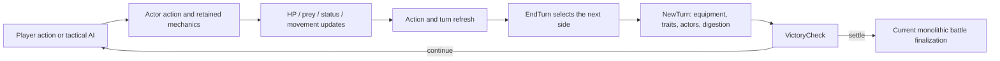
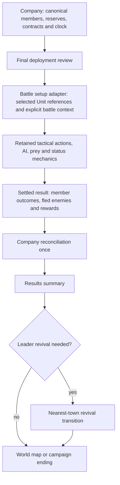

# Architecture study 01C — combat, equipment, and battle results

**Status:** Third study packet ready for review, 2026-10-30. Documentation/source inspection only; no gameplay implementation, Unity launch, build, or playtest was performed for this packet.

**Design follow-up:** [The 2026-10-30 decisions](../design-clarifications-2026-10-30.md) resolve most choices this study raised: all surrendered states become downed; no ordinary permanent death, no legacy resurrection/conversion, temporary HP absorbs damage first, nine typed gear slots, leader revival/game over only after completed digestion, and global disabling preserves existing individuals. There is no left-behind state: simulate actual outcomes while standing enemies face downed members. Both sides inactive or an excessively long stalled battle instead trigger stalemate; remaining units flee, and enemies count as defeated for contracts even on a draw. The source descriptions below remain descriptions of the unchanged legacy game, not approved behavior to inherit.

## Findings that affect the conversion

The tactical actor already wraps the Unit used by the army, so its core stats and combat behavior are useful preservation targets. However, battle setup and finalization depend on the old strategic game. They prepare garrisons, apply building effects, resolve diplomacy, route escaped troops to towns, handle several revival/replacement systems, transfer loot, and update empire statistics. The company needs its own setup/result owner around the retained combat engine.

Surrender is not simply a label for a unit at 0 HP. Normal automatic surrender changes lethal damage into 1 HP, is conditional on settings/traits, can change sides or heal the unit, and interacts with consumption/escape. Other effects can cause surrender above lethal HP. An all-surrendered safeguard clears the surrender state, and remaining-unit logic can keep surrendered units in a battle. The agreed downed rule therefore needs explicit lifecycle changes alongside the new presentation.

Equipment expansion requires coordinated data and consumer changes. SetMaxItems forces inventories back to two or three slots, and item uses/cooldowns have their own three-element arrays. Accessories directly modify stored stats and can modify current HP when equipped. Simply raising NewItemSlots would neither preserve full loadouts nor guarantee safe stat/save behavior.

Persistent injuries cannot live only in the current StatusEffects collection: battle finalization clears it. The injury system also cannot observe only Actor_Unit.Damage because digestion and other health changes use lower-level or direct writes.

## Evidence and limits

- [Equipment and lifecycle reference candidates](01c-equipment-reference-inventory.md): 331 matching lines across 41 source files, including sizing, uses/cooldowns, item mutation, equipment callbacks, and potion paths.
- [Damage and outcome reference candidates](01c-damage-outcome-inventory.md): 131 matches in selected central files, including HP writes, surrender/flee transitions, digestion cause, death bookkeeping, and status cleanup.

These are lexical review inventories, not lists of confirmed bugs or an exhaustive runtime call graph. Matches include initialization, healing, costs, comments, and safeguards; they must not all produce injuries or death notifications. Existing baseline evidence still covers compilation, a Windows build, and user-confirmed main-menu startup only.

## 1. Tactical data and unit identity

| Object | Current responsibility | Conversion implication |
|---|---|---|
| [Unit](../../Assets/Scripts/Entities/Units/Unit.cs) | Name, species/appearance, stored stats, HP/resources, experience, traits, items, spells, side/controller state, copy/morph data | Reuse retained mechanics, but attach stable company-member identity outside mutable appearance/side/copy fields. |
| [Actor_Unit](../../Assets/Scripts/Entities/Units/Actor_Unit.cs) | Tactical position/movement, visibility/targetability, surrendered/fled flags, equipped-weapon caches, prey reference, damage/action methods | Temporary battle wrapper, not the whole persistent mercenary record. |
| [Prey](../../Assets/Scripts/Entities/Units/Prey.cs) | Actor and Unit references, predator, nested prey, location, digestion/escape counters | A contained unit is not automatically dead or permanently lost; preserve its real outcome. |
| [PredatorComponent](../../Assets/Scripts/Entities/Units/PredatorComponent.cs) | Containment lists, capacity, digestion, escape/release/transfer, retained outcome effects | Keep retained mechanics; provide accurate outcome notifications without replacing them with downed logic. |
| [Army](../../Assets/Scripts/Entities/Army.cs) | Unit collection plus strategic identity, movement, healing, item stock, empire connection | A battle adapter may temporarily reuse an Army shape, but must not expose the whole company roster as a mutable army collection. |
| [TacticalData](../../Assets/Scripts/Utility/Stored/TacticalData.cs) | Serialized actors, armies, village, map, selected unit, sides/turn/control data and more | In-battle saving must preserve a connected graph and the campaign's pending result identity; packet 01D must resolve that design. |

[TacticalMode.Begin](../../Assets/Scripts/Modes/TacticalMode.cs#L402) constructs Actor_Unit wrappers using the Units already present in the supplied armies. It does not create an independent copy of every persistent unit. Retreat then removes that Unit reference from an army collection. Passing the canonical company roster collection directly would therefore allow tactical behavior to remove members before company reconciliation and would deploy reserves unless filtered first.

Copy/morph mechanics need separate attention. [Unit.CopyTacticalUnit/RevertCopiedUnit/HardCopyUnit](../../Assets/Scripts/Entities/Units/Unit.cs#L3625) can copy names/species/stats and assign item/uses/cooldown arrays by reference. These are gameplay transformations, not a general-purpose safe battle-copy strategy. A member's debt, injuries, history, and memorial identity must survive them without following a temporary name or copied appearance.

## 2. Battle setup and terrain

The current campaign path is [GameManager.ActivateTacticalMode](../../Assets/Scripts/Core/GameManager.cs#L382): save the strategic camera, hide StrategyMode, derive sides and tactical control from Empire/Village, update relations for attacks, obtain nearby building effects, and call TacticalMode.Begin. Pure Tactical uses ActivatePureTacticalMode with explicit armies/AI and a different return path.

Begin stores two armies plus optional Village, computes map size from combatant/garrison counts, generates a tactical map, processes defections, obtains garrison units, finds leaders, and wraps every supplied army member. Later setup also applies building effects/reinforcements, equipment start hooks, trait/summon behavior, side visibility, and AI initialization. There is no new-company active/reserve boundary here yet.

The final deployment screen must run before Begin. It should create a collection of selected active members, always include the leader, and keep reserves in company state. Their existence matters to company survival and revival even though they have no tactical actor.

[TacticalMapGenerator](../../Assets/Scripts/Modes/Tactical/TacticalMapGenerator.cs#L32) has seven terrain families:

| Strategic tile/context | Tactical family |
|---|---|
| Forest | Forest |
| Snow/snow hills/snow fields without a village | Snow |
| Desert/sand hills/desert fields | Desert |
| Volcanic/ashen/ashen hills/ashen fields | Volcanic |
| Shallow water/small islands | Beach |
| Swamp/dry swamp | Swamp |
| Remaining cases | Grass |

The grassland/desert mapping discussed earlier is only part of the existing implementation. Terrain generation is reusable, but village walls/buildings/garrison effects should not follow an ordinary contract target into the company mode accidentally. Map generation uses both UnityEngine.Random and State.Rand; reproducibility needs explicit treatment in packet 01D.

## 3. Turn loop and tactical AI

[ITacticalAI](../../Assets/Scripts/AI/ITacticalAI.cs) exposes RunAI, ForeignTurn, and RetreatPlan. TacticalMode selects legacy or race-configured AI implementations through RaceAIType and may refresh the implementation for the next actor/mind-control context. [TacticalAI](../../Assets/Scripts/AI/TacticalAI.cs) handles target selection, path/action choices, visibility, surrender-sensitive behavior, and retreat decisions.

[EndTurn/NewTurn](../../Assets/Scripts/Modes/TacticalMode.cs#L4426) switch active sides and AI, advance the tactical round, tick equipment/traits/statuses, update actors, process retreated digestors, and check results. The normal frame-driven AI and TurboMode both call RunAI; TurboMode repeatedly ends turns and checks victory. Keep both paths in the regression review so skirmish bulk tests remain meaningful.

Tactical AI is distinct from empire-turn AI, but not completely independent of the old world. It accesses TacticalUtilities, TacticalMode, World.IsNight, side/hostility helpers, State.RaceSettings, and strategic power estimates. InitRetreatConditions also interprets Empire/MonsterEmpire and species-specific rules. Preserve decision behavior through an explicit battle context/adapter before removing those providers; simply keeping ITacticalAI does not isolate all dependencies.

Tactical rounds must not call the new campaign's daily scheduler. StrategyMode's later regeneration/return work must be replaced deliberately so exiting a battle does not consume a day or run an empire turn.

## 4. Stats, leadership, and equipment

### Effective stats and leadership

[Unit.GetStat](../../Assets/Scripts/Entities/Units/Unit.cs#L1773) combines stored stat, leader bonus, trait bonus, and status bonus, then applies scale/general/specific multipliers and clamps to a minimum of one. Trait caches are rebuilt from ordinary, permanent, shared, and conditional traits; the runtime Trait system remains a preservation target even when its authoring tools disappear.

GetLeaderBonus reads CurrentLeader's stored Leadership divided by ten. Begin assigns CurrentLeader to army/garrison participants and also heals each actor by three times that bonus during setup. Removing the Leadership aura therefore includes the actual stat and setup-heal paths, not just a trait name or icon. Existing auto-leadership growth and leadership terms in power estimation need coordinated review for the new free leader role.

MaxHealth has a configuration-dependent branch that can update Health as its computed maximum changes. Injury/gear calculations must account for this side effect instead of treating every stat getter as pure. Persistent injury penalties need a clear application/removal owner and cannot be applied repeatedly on every load or refresh.

### Loadout dependencies

| Component/path | Current behavior | Migration risk |
|---|---|---|
| Config.NewItemSlots / World.ItemSlots | New slot count normally starts at two | Changing this constant alone is insufficient. |
| Unit constructor | Allocates Items by configured slots but uses/cooldowns with fixed three-element storage | Expanded equipment can index beyond parallel storage. |
| [SetMaxItems](../../Assets/Scripts/Entities/Units/Unit.cs#L2213) | Forces two slots without Resourceful, three with it; called during trait/copy/morph-related refresh | Larger loadouts can be truncated/reset after apparently unrelated actions. |
| [SetItem/AddAccessory/RemoveAccessory](../../Assets/Scripts/Entities/Units/Unit.cs#L3089) | Adds/subtracts accessory bonuses directly in Stats; Endurance changes also alter current HP | Re-equipping or restoring saved loadouts can double-apply stats or interact with healing unless state ownership is explicit. |
| Equipment callbacks | Typed activators invoke object-array callbacks for battle/turn/damage/heal/attack/spell events | Some callbacks expect Actor_Unit/Army; retain required behavior without old campaign objects. |
| EquipmentFunction iteration | Iterates Items.Length, then uses slot index in ItemUses/ItemCooldowns | A dynamic item loop is not proof that variable slot counts are safe. |
| GetBestMelee/GetBestRanged | Scans items; melee prefers damage, ranged prefers range; Feral uses natural attacks | More weapon slots can change which attack AI/UI uses. Define hand/weapon rules before allowing arbitrary combinations. |
| Recruit_Mode / exchange UI | Old purchases and fixed-gear/slot-zero tests assume army/village state | New roster/shop interfaces need loadout compatibility checks and an inventory owner. |
| Copy/morph/shifter shapes | Share or copy item/stat state and may call SetMaxItems | Decide what remains temporary and preserve canonical item ownership. |
| Potion systems | Potion inventory/stock/refill plus separate EquipmentFunctions health/mana consumable callbacks | Disabling the PotionSystemEnabled page alone does not prove all potion gameplay is gone. |

Item classes include Weapon, Accessory, SpellBook, and Equipment with callback/use/cooldown behavior. The inspected types do not provide the intended dedicated body armor/coverage model. A cosmetic clothing choice is not automatically mechanical armor coverage. Slot types and armor's injury-prevention contribution are new design/data work, not a reskin of the current two slots.

The future item-power model must also distinguish a stored stat already changed by an accessory from an independent gear contribution. Do not score the same bonus twice merely because it appears in both a stat and the item definition.

### Existing power estimates

[StrategicUtilities.ArmyPower](../../Assets/Scripts/Modes/Strategic/StrategicUtilities.cs#L717) combines weapon factor, species PowerAdjustment, scale, exponential level/leadership terms, then multiplies the summed member power by member count. UnitValue is a different sum used by summaries. Neither is the agreed new additive contract budget covering all stats, abilities, traits, and equipment.

These helpers are useful references, but copying them as the new rating formula would import leadership assumptions and non-linear headcount effects, particularly relevant to swarm compositions. Tactical AI uses ArmyPower for retreat evaluation. Introducing a contract model must not silently change AI retreat policy through a shared helper replacement; any adaptation should be deliberate and reviewed.

## 5. Damage, surrender, containment, and death

### Main damage paths

Weapon input → TacticalMode.MeleeAttack/RangedAttack → Actor_Unit.Attack/Defend → hit/equipment/trait evaluation → Actor_Unit.Damage → resistance/barrier handling → SubtractHealth → surrender/death side effects. Spell damage has its own defense/multiplier path before calling Damage. Status, environmental, equipment, and health-cost paths also exist.

[SubtractHealth](../../Assets/Scripts/Entities/Units/Actor_Unit.cs#L3225) updates HP, damage timing, and OnDamage equipment. [Damage](../../Assets/Scripts/Entities/Units/Actor_Unit.cs#L3271) adds resistance, barriers, trait reactions, automatic surrender, visibility/targetability changes, and live-prey release. A health change is not always an injurious hit: initialization, healing, costs, and prevention/resistance must be distinguished.

Digestion goes through Actor_Unit.DigestCheck → PredatorComponent.Digest → CalculateDigestionDamage/DigestOneUnit. It can call the prey actor's SubtractHealth directly and separately sets KilledByDigestion, KilledBy, death/trait effects, or alternate outcomes. Hooking injuries only in Damage would miss that path; hooking both methods independently could count one ordinary hit twice. Design an actual-HP-loss observation with explicit cause/context, then apply the agreed hit and deep-attrition checks intentionally.

### State distinctions

- Unit.IsDead is Health < 1. Unit.Kill increments death bookkeeping and may revert copied identity; it does not itself universally set Health to zero. Polling Kill calls alone is not a complete death detector.
- Actor_Unit stores Surrendered, Fled, Visible, Targetable, and SelfPrey separately. KilledByDigestion is a cause marker, not a substitute for the final outcome.
- Successful consumption makes the target invisible/untargetable, sets movement to zero, and adds a Prey wrapper referencing the same actor/unit. It is not immediate death.
- Surrendered affects GetDevourChance (which can return certainty on that path) and Prey.UpdateEscapeRate (which can suppress escape). Renaming the state while preserving its uses preserves substantial gameplay behavior.
- Damage can produce surrender above lethal HP through traits such as Cowardly. Normal lethal auto-surrender is conditional on AutoSurrender/chance, Fearless, current surrender state, digestion cause, and Respawns status; the nonlethal canKill=false path also enters it.
- That surrender path restores HP to one and may convert alignment, grant a full heal under GoddessMercy, or release live prey. The new universal downed rule must not accidentally inherit all of those optional behaviors.
- ButtonCallback case 9 can toggle voluntary surrender; case 10 invokes retreat. The skip/simulation UI also has a surrender option reaching ProcessSkip/SurrenderAll. Removing one visible button leaves another player-controlled route unless reviewed.

### Battle completion versus company survival

CalculateRemaining counts living, non-fled units and tracks surrendered counts without simply excluding surrendered units. It also considers prey, special escape/stamina behavior, and orphaned containment repair. After 500 rounds, an all-surrendered side can have HP forced to zero. NewTurn's AllSurrenderedCheck can clear surrender flags when no active visible fighter remains. Those anti-stall rules are incompatible with assuming that every downed member stays down until normal company reconciliation; they need deliberate adaptation.

The company needs separate concepts for combat-capable deployed fighters, living/contained deployed members, reserves, and final permanent losses. The legacy remaining-army count cannot decide company wipeout because reserves have no actor. Nor can a contained member be recorded as dead merely because no visible fighter remains. Settled vore/digestion outcomes continue to take precedence over treating a non-digested 0-HP casualty as downed.

The injury design remains probabilistic: reaching 0 HP does not guarantee serious injury and should not be treated as a much more severe injury threshold than near-zero HP. Those are new injury rules, not deductions from the old surrender code.

## 6. Retreat and delayed outcomes

[AttemptRetreat](../../Assets/Scripts/Modes/TacticalMode.cs#L3361) uses the attacker's top edge and defender's bottom edge, not every boundary interchangeably. Normal retreat requires movement and obeys turn/trait restrictions; summons, Fearless, and special mercenaries have additional exclusions. A fromWarp route bypasses those normal conditions. Preserve the agreed existing edge-and-click interaction while reviewing retired special-species restrictions through curation.

RetreatUnit removes the Unit from its army collection, adds it to a retreated list, hides/disables its actor, sets Fled, and retains a digestor reference when it carries prey. NewTurn continues processing those digestors. VictoryCheck may also advance their digestion before settling. Leaving the visible battlefield therefore does not necessarily finish the fate of every contained character.

On victory the old game can ask whether fled troops return to the army or keep fleeing to a town. ProcessFledUnits ultimately calls TacticalUtilities.ProcessTravelingUnits, which routes/scatters survivors using old villages, pathfinding, and invisible traveling armies. Replace that strategic travel/report behavior with the agreed nearby company destination. Do not let a fleeing contract enemy become another persistent roaming army: enemies that flee count as defeated and leave the converted game as agreed.

## 7. Current result finalization and what must change

[VictoryCheck](../../Assets/Scripts/Modes/TacticalMode.cs#L4678) is both a victory detector and a large state-changing finalizer. Its path includes:

1. Calculate remaining units; defer for active hostility/recent damage and unresolved digestion, including retreated predators. Handle special escape/containment outcomes, recalculate, and potentially resume fighting.
2. Prompt about returning fled units and optionally pause for battle review. Dialog callbacks can invoke VictoryCheck again, so callers must not assume it is a pure query.
3. Revert post-battle copies, process Replaceable, give experience, fully heal some regenerators, revert morphs, clear StatusEffects, remove barriers, run equipment end hooks, and replenish potions from army stock.
4. Apply building soul/reinforcement effects and a set of survival/revival/reincarnation/saved-copy behaviors. Some paths restore full HP or one HP, rename a replacement unit, enqueue a future incarnation, or return an imprinted copy to a village.
5. Return or reroute fled units, allocate leftover troops, update world battle/army statistics and territorial claims, process corpses/surrendered allies, clean village ownership, apply bounty goods, and transfer items.
6. Fill the existing statistics UI or immediately SwitchToStrategyMode. StatScreenPanel's close/timer path calls GameManager.CloseStatsScreen, which also switches back to strategy; Pure Tactical is redirected to main menu through its existing branch.

Traits in these paths include Eternal, LuckySurvival, Reformer, Revenant, DeathCheater, CloseCall, Transmigration/Reincarnation variants, Replaceable, and saved-copy effects. They are not the new leader revival service and cannot be inherited as its implementation. The user has now permanently deprecated these loss-bypassing effects; no removal has been implemented by this study. Copy/illusion spells are separately allowed as temporary summons, not as persistent replacements.

Existing loot handling primarily transfers army/village stock and specific dropped items such as spell books. That does not establish a new general full-equipment-drop policy. Initial contract rewards remain gold only; any retained battle loot behavior must be distinguished from the promised contract payout.

Existing TacticalStats/World.Stats summarize side performance. They are not a reliable per-member memorial record. Record stable identity and final cause/captor/killer information before cleanup removes actors or rewrites identities, then reconcile the settled result. Do not infer final fate from randomized prose, a single HP test, or an aggregate defeated-unit count.

## 8. Proposed battle boundary for the company campaign

This is a proposal to refine with packet 01D, not a new implemented interface:

The setup should supply selected member identities/references, leader identity, explicit sides/control/AI, terrain, and required battle-only rules/context. Any temporary Army-shaped compatibility collection must be separate from the canonical roster, with only deployed members. Static TacticalUtilities and AI/world lookups need reviewed providers rather than a hidden running empire simulation.

The result should distinguish survived, downed, fled, digested, otherwise permanently lost, and any approved temporary/transformed state. It must identify enemy rout progress, actual payouts, and pending leader revival. A campaign-owned battle/result identifier should prevent duplicate rewards, losses, or memorial entries across repeated callbacks and save/load; exact persistence belongs to 01D.

With revival disabled, completed leader digestion must end the campaign immediately, rather than waiting for VictoryCheck to finish review/loot. Mere downing does not trigger revival or game over; a surviving downed leader gets the ordinary survivor HP baseline. With revival enabled, remaining battle outcomes and normal victory rewards settle before the summary/revival cutscene. Reserves preserve company survival, and the forced trip advances no campaign days. Do not reuse an unrelated Eternal/CloseCall or village-copy path as that service.

Pure Tactical retains the common battle rules, downed presentation, and in-battle injuries, but has no company wages/debt, persistent injuries, contracts, memorial, or revival campaign transition. Its return branch must keep working as the old campaign branch is replaced.

## 9. Migration batches and checks to carry into specs

| Spec | Source-based preparation | Required later check |
|---|---|---|
| 05 combat isolation | Separate battle setup/result ownership from diplomacy, garrisons, buildings, traveling armies, stats returns, and static world assumptions | Battle setup and both exits work without an active empire simulation; AI retains required context. |
| 07 leader/company | Separate persistent leader identity from old leadership aura, growth, unit-type special cases, and temporary copies | Leader always deploys, costs no wages, keeps personal identity, and grants no unwanted aura/setup heal. |
| 08 equipment | Replace SetMaxItems, parallel storage, accessory mutation assumptions, copy/shifter paths, and old shop/slot-zero logic | Loadout survives trait refresh, save/load, morph/revert, equipment cooldowns, and UI changes without truncation or duplicated bonuses. |
| 09 power generation | Existing ArmyPower/UnitValue are legacy approximations with leadership/nonlinear-count terms | New rating accounts for intended contributions without double counting; swarm forces and AI retreat behavior are reviewed separately. |
| 10 outcomes | Adapt surrender/anti-stall/counting, cause tracking, legacy revivals, retreat-with-prey, reserves, result reentry and UI return | Victory, retreat, all active members downed, digestion, reserves surviving, leader revival on/off, and wipeout settle once. |
| 11 injuries | Persistent data outside StatusEffects; observe actual positive HP loss across ordinary and digestion paths | Injury checks respect mitigation and causes, do not count healing/costs as attacks, and do not double-count a hit. |
| 12 integration | Exercise normal, skipped/turbo, and Pure Tactical routes plus retained life/trait exceptions | No hidden empire turn/time advance, skipped leader death, duplicate reward, lost reserve, or resurrected memorial entry. |

The source study itself introduced no new mechanics or formulas. Subsequent user decisions are recorded in the linked clarification document and affected specs; outstanding numeric balance choices and flagged conflicts remain unresolved, not implementation defaults. Packet 01D still covers world/clock ownership, campaign persistence, stable identity, and the consolidated dependency/removal sequence, now including separate lasting/temporary HP, disappearing summons, persistent disabled-species individuals, and turn-by-turn Ironman feasibility.
