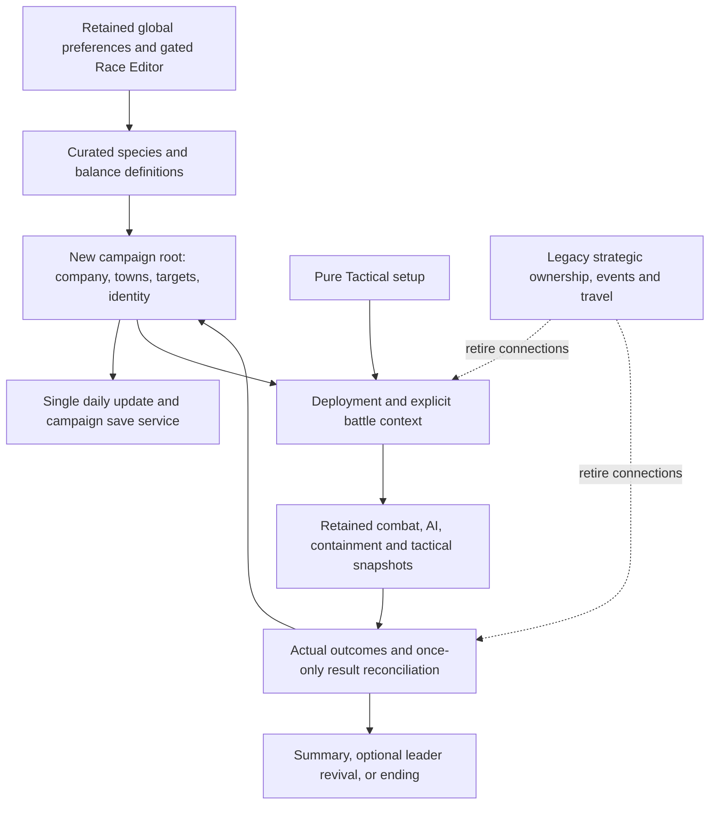

# Consolidated conversion boundary, retirement sequence, and risks

**Status:** Review proposal, 2026-10-30. Reconciles architecture packets 01A–01D and the user's design clarifications. Documentation only; no implementation, file moves, deletions, or new testing authorization.

Read [01D's campaign/save findings](01d-campaign-persistence-and-identity.md), [the campaign design](../mercenary-company-campaign-plan.md), and the exact [screen](../screen-curation-checklist.md), [options](../options-curation-checklist.md), and [species](../species-curation-checklist.md) lists. These tables summarize their scope; they do not replace exact removal lists or grant file-deletion permission.

## Dependency boundary

Campaign days and tactical turns are separate. Skirmish shares combat but does not own company wages, persistent recruits, contracts, memorial, or revival transitions. Keeping a compatibility shape such as Army/World is acceptable only with its residual responsibilities named; running their entire old simulation is not the intended clean slate.

## Keep/adapt/retire manifest

| Feature group | Disposition and source/dependency evidence | New owner or disconnection point | Batch/spec |
|---|---|---|---|
| Settings defaults and persistence | Adapt ContentSettings, WorldConfig, PlayerPrefs and State.Load; control creation/load/exit currently provide values | Explicit code balance defaults plus retained global player preferences; no UI-object dependency for retired controls | 02A |
| Strategic Gameplay, Building Settings, Tactical Misc, Vore Advanced/Misc, selected Vore Main/Post-Vore controls | Retire exact controls/pages from options checklist; positional page selector and BuildingSettings lifecycle calls in 01A | Replace reads/writes/load precedence before disconnecting panels; distinguish menu cleanup from confirmed mechanic retirement | 02C |
| Gender, Appearance, General Options and cosmetic tactical flags | Keep agreed preferences; 01A identifies AutoUseAI and maintenance actions as additional behavior | Retained settings service/UI; do not wipe preferences or decide additional removals by name | 02A/C |
| Old Fog settings | Legacy page disposition requires final affected-batch decision; live FogSystem has faction/research assumptions | Mandatory company discovery model; no hidden legacy flag bypass | 02C / 06 |
| Empire Traits, Cheat Menu, Map Editor, World Settings, Bestiary, tutorial | Retire entry points, direct activations, update/close/input dependencies; 01A scene inventory and GameMenu/GameManager routes | Application shell and new company creation; help navigation remains | 02B / 05 |
| Randomizer, Custom/Conditional Trait, Assimilable, Unit and Variable authoring tools | Retire exposed editors; retain runtime trait data/functions needed by combat and gated Race Editor | Close InfoPanel/UnitInfoPanel links and reflection routes, not just menu buttons | 02B |
| Race Editor and nested Unit Tags Options | Keep all normal tabs, gate all enabled contexts; presets/data slots and nested helper routes in 01A | Shared convenience password gate; no standalone Unit Tag entry | 02B |
| Species controls/selection | Replace enum-built pages/dropdowns, random ranges and direct mappings; 01B creation-site inventory | One curated role/enablement policy; disabled existing individuals remain valid | 03A with 02C |
| Rejected species and named uniques | Retire all 90 mapped entries and unique-generation paths, dependencies first; preserve numeric identity while referenced | Explicit unavailable definitions and removal manifest; no uncurated fallback | 03B |
| Shared art/name/data resources | Adapt eager registries, shared bundles, aliases and startup seeders described in 01B | Keep shared required resources until loader/reference replacement is proven; personal files are not deleted | 03B / 04 |
| Existing combat prose | Replace 22 text groups, inline/helper/callback routes and dummy contexts from 01B with neutral functional placeholders | Retained log/event keys; user writes new prose; preserve mixed mechanical callbacks | 04B |
| Existing 4X events | Retire player/AI triggers, 36/32 cases, custom definitions/loaders/seeders, choice effects, callbacks | No active old event dispatch; generic UI retained only with reviewed company-independent behavior | 04A |
| Empire campaign creation and World construction | Retire old start flow, constructors with empire placement/start-turn effects | Unavailable company entry until new creation is ready; explicit skirmish route still safe with empty roster | 05A / 06 |
| Empire turns, conquest, economy, diplomacy, research, buildings, population | Retire StrategyMode.EndTurn/BeginTurn/ProcessGrowth/ProcessIncome and corresponding triggers | New daily updater; no negative-gold auto-dismissal, automatic leader replacement, or territorial game ending | 05A / 06–07 |
| Grid/terrain/rendering/pathfinding | Keep reusable algorithms/types/assets, adapt empire assignment/occupancy and cache invalidation | Generated region, static towns/targets and company movement; persisted discovery instead of live allied visibility | 05B / 06 |
| Recruitment, army roster, training, potions and shops | Retire old entry/lifecycle paths; keep Unit/item/stat infrastructure | Company/candidate registry, town offers/wages, passive sparring, nine typed slots and new commerce | 05A / 07–08 / 11 |
| Battle setup and return | Adapt GameManager, TacticalMode.Begin, StatScreenPanel, traveling units and building/diplomacy providers | Deployed-only collection, explicit context, actual outcomes, company return or skirmish menu | 05C / 10 |
| Combat, tactical AI, terrain, containment | Keep retained mechanics and both ordinary/turbo AI paths; replace static old-world providers | Battle context/snapshot, not running empire scheduler | 05C / 10 |
| Resurrection/replacement, permanent animal polymorph, excluded conversion, spontaneous allegiance switches | Permanently deprecate approved effects across spell/trait/equipment/callback providers; temporary clones/illusions are distinct | No alternate permanent-life path; only leader's digestion-triggered cutscene | 05C preflight / 10 |
| Surrender/downed, damage/healing, retreat, ending | Adapt actual state/targeting/AI/outcome paths, not labels alone; 01C inventory | Persistent downed until battle end, nonfatal collateral, disappearing summons, temporary HP first, captive-safe enemy retreat, actual digestion, stalemate | 10 / 11 |
| Contract difficulty and rewards | Replace legacy ArmyPower/UnitValue as campaign budget; preserve/review AI retreat coupling separately | Saved procedural targets, power model, reputation and once-only rewards; fleeing enemies count defeated even on draw | 09–10 |
| Legacy save/load, preview, quick/autosave, mode inference | Replace World-root/version and MainEmpires-null routing before new company integration | Explicit format/schema/mode, canonical identities, resumable transitions and validated backups | 05C boundary / 06 / 10 |
| Injuries, recovery and statistics | New persistent state; don't reuse cleared StatusEffects or aggregate legacy deaths as memorial | Member injury history, daily recovery, survivor baseline, actual final fate and company statistics | 10–11 |
| Help and later events/POIs | Rewrite help after loop works; old events never return as replacement content | Specs 12/13; later user-authored prose and species expansion | 12–13 |

Each grouped row inherits its exact entries from the linked inventories. An entire C# file, prefab, resource bundle, or scene is not declared safe to remove merely because one retired feature references it.

## Proposed reviewable cleanup order

Spec numbers identify responsibilities, not an instruction to finish all of 02 before touching 03. Keep the cross-spec dependency order explicit:

1. **02A — Defaults without widgets.** Record retained defaults/load precedence and replace control-dependent initialization. Separate code balance from mutable preferences/saved overrides. No visual removal yet. Review old-settings behavior without clearing user data.
2. **02B — Close retired routes and gate Race Editor.** Resolve affected scene/prefab bindings, menu/hotkey/direct/link paths, and close/update handlers. Preserve all Race Editor tabs/nested tags. Retired screens become unreachable; shared helpers remain until their other callers are addressed.
3. **03A with 02C — Curated eligibility and replacement species page.** Explicitly support zero curated species in startup, previews, random generation, summons and bulk tools. Replace fallback Cats/Humans/Vagrants assumptions and old data slots. Then retire confirmed settings pages/control bindings and their load/save calls. No rejected species is temporarily chosen just to make a battle launch.
4. **04A — Retire old events at their sources.** Disconnect both trigger families, startup/custom loading and choice callbacks; neutralize EventScreen's strategic regeneration before reuse. Do not delete user events files or generate new company events yet.
5. **04B — Functional text reset.** Replace old prose and race-dependent dummy contexts across registered/inline/helper routes, preserving mechanical callbacks. Make the shared RNG consequence explicit. This prepares references that would otherwise block rejected-species cleanup.
6. **03B — Retire rejected species dependencies.** Use the 90-name map for registries, parameter/graphics/name/override/summon/spawn references and named uniques. Keep serialized IDs stable where still needed. Shared bundle ownership/repacking and remaining callers need proof before whole-file retirement; no file deletion/move is authorized here.
7. **05A/B — Disconnect the 4X scheduler and creation, retain reusable map services.** Remove live creation/turn/economy/ownership/event routes and auto-dismissal/replacement paths. Isolate terrain/path/render services from village/empire data. Keep new campaign entry clearly unavailable until 06/07.
8. **05C — Finish combat/save/application boundaries.** Replace setup/return/static context providers and legacy mode inference. Retire approved revival/conversion effects without removing temporary summons. Review residual World/Army dependencies and skirmish exit. Establish the explicit new-format route before new campaign state arrives.
9. **Phase 2 review.** Report disabled/retired routes and necessary residual internals, exact performed/pending checks, empty-roster limitations and remaining scene/resource work. Only after accepted review start 06–10 company implementation, followed by 11–12. New downed/temporary-HP/injury mechanics are implementation work in those specs, not secretly included in prose cleanup.

Every batch still needs its concrete source diff and applicable GPL modification notices/CHANGES entry. The retained application's temporary empty-roster state is expected; it is not proof that actual combat has been regression-tested. Re-enable the user's first curated species in 07 and finish previously blocked combat checks then.

## Risk register and required later evidence

| Risk | Mechanism/evidence | Mitigation and planned check |
|---|---|---|
| Retired UI breaks initialization | ContentSettings.Refresh/load/exit creates and dereferences widgets; indexed panels and prefab overrides | 02A before 02C; resolve fourteen outstanding bindings/inherited callbacks before affected scene changes; exercise retained settings and both exits. |
| Old content reappears | External files, RaceSettings slots, direct race writes, eager registry, fallback constructors | Filter actual generation/selection, retire seed/read paths, preserve supported existing identities, and review load/new-game/bulk/summon routes. |
| Saved settings bypass code balance | State.Load replaces Config.World; old cheat/preferences are loaded | New format + explicit allowed preference ownership; never restore legacy balance controls into a new campaign. |
| Recovery runs extra systems | Army.Refresh/GetTileHealRate and strategic regeneration perform more than healing | Extract pure selected effects; compare one End Day with equivalent interrupted rest; battle return/load cannot tick days. |
| Downed character pruned as dead | Unit.IsDead uses HP; Army.Prune removes and counts deaths | Separate actual digestion/fate from HP; no canonical roster through legacy pruning; check saved downed members and survivors. |
| Wages take control away | ProcessIncome auto-dismisses and zeroes HP | New personal-debt loop; group payment only by player choice; rest warning pauses before grace-day expiry. |
| Identity splits or duplicates | Same Unit referenced by armies/actors/prey, copied arrays, mutable species/name/side | Stable registry/bindings; round-trip candidates/members/former members, reserves and nested prey; resolve each to its canonical identity. |
| Load re-enters retired campaign/skirmish | MainEmpires-null mode inference; migrations and strategic UI before tactical resume | Explicit mode/schema; prospective validation before live mutation; unsupported old format fails clearly. |
| Partial or corrupt save loses Ironman | Direct overwrite; Save returns no success; no generation fallback | Explicit acknowledgement and multiple validated generations; narrow failure/recovery checks when authorized. |
| Turn snapshot half applied | Tactical EndTurn/NewTurn/effects and turbo advance state; UI callbacks aren't persisted | Stable checkpoints or serialized progress; no AI action between checkpoint boundary and publication; test all supported save phases. |
| Reward/revival repeats | VictoryCheck mutates, dialogs reenter, result transition can be saved | Battle/result IDs plus resumable/transactional effects; reload before/after payout, summary, memorial, revival; exactly once. |
| Stalemate conflicts with contract/result label | Draw survivors flee, enemies count defeated; no assumed abandoned deaths | Separate tactical result, target completion and company survival; actual simulation until terminal/stalemate; verify earned draw rewards. |
| Captive disappears off map | RetreatedDigestors and special/AI/forced flight paths | Enemy must release first or be blocked; stalemate returns living participants safely; verify nested prey and fled actors. |
| Item/stats corrupt across loading | Dynamic Items but fixed arrays; SetMaxItems; direct accessory stats; name remapping | Typed nine-slot loadout, stable item definitions and idempotent refresh; check HP symmetry, uses/cooldowns and copies. |
| Text edits change random mechanics sequence | State.Rand shared with logs; Unity randomness and clock-seeded noise | Explicit RNG plan; don't promise old sequence identity; save generated world and chosen offers, assess owned state for continuation. |
| New exploration acts like old live fog | FogSystem resets visibility and reveals allied towns/buildings | Save discovery independently; travel away/load retains discoveries; contract marker doesn't require faction simulation. |
| Region or target inaccessible | Empire placement/farmland heuristics, cached occupancy/passability | Shared passability/reachability validation for starter town, targets, retreat and revival; bounded generation failure. |
| Retiring one species breaks others | Aliases and four mixed bundles, numeric identities, shared content | Preserve shared dependencies until proven; no numeric renumbering or blanket bundle deletion. |
| Missing baseline coverage | Only import/build/main menu established; scene capture/combat/save checks pending | Keep these limits in spec 00; authorize and run narrow checks with implementation/first approved roster rather than claiming prior coverage. |

## Scope limits and first executable packet

The recommended first implementation packet is **02A only**: separate defaults/configuration ownership from widgets and document retained values and load precedence. This makes later screen removal reviewable without simultaneously changing combat, species content, campaign rules, or serialized scenes. It remains a proposal awaiting user review of this architecture packet.

Fourteen unresolved 01A control bindings, inherited prefab details, asset-bundle ownership and any newly discovered dependent caller remain explicit implementation preflights. They do not require the user to inspect code or choose technical defaults. Public release licensing/dependency review and all required Unity runtime checks remain separate work. This report is not a claim that all possible runtime paths or third-party terms have been audited.
